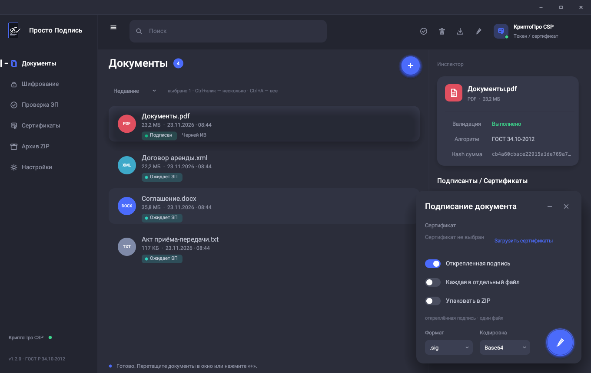

# Просто подпись

Десктопное приложение для подписи, проверки и упаковки документов по
ГОСТ Р 34.10-2012 (Streebog-256) через КриптоПро CSP. Закрытый ключ не
покидает контейнер: подпись выполняется средствами CSP.

<p align="center">
  
</p>

<p align="center">
  
</p>

## Возможности

- **Документы** — очередь файлов с поиском, сортировкой, Drag & Drop,
  выбором нескольких файлов (`Ctrl+клик`) и всех сразу (`Ctrl+A`).
- **Подписание** — два независимых режима:
  - *открепленная* подпись отдельным файлом или *присоединенная*
    (содержимое документа внутри CMS);
  - отдельный файл на каждый сертификат или **одна общая подпись**
    со всеми подписантами.
  Дополнительно: ZIP, `.sig` / `.p7s`, Base64 / DER.
- **Сертификаты** — загрузка из `Cert:\CurrentUser\My` и импорт
  `.der` / `.cer` / `.pem`.
- **Проверка ЭП** — Base64 и бинарный DER/BER (CryptoPro, портал
  e-trust.gosuslugi.ru). Строгий лимит 80 МБ на документ и подпись;
  после успешной проверки подпись переименовывается в
  `<имя документа>_<Фамилия_ИО>.sig`.
- **Отчёт о подписях** — после подписания рядом с документами появляются
  `Отчёт о подписях.txt` и `Отчёт о подписях.xlsx`: подписант, файл
  подписи, SHA-256 подписи, дата. Кнопка «Открыть папку» открывает
  папку в Проводнике.
- **Тёмная тема**, безрамочное окно, собственные элементы управления,
  векторные иконки.

## Структура

```
app/   — GUI на Rust + egui (Podpis.exe)
cli/   — движок подписи/проверки (cryptoline.exe → cryptoline-cli.exe)
```

## Требования

- Windows 10/11 x64
- КриптоПро CSP с контейнером закрытого ключа
- Сертификат с ключом ГОСТ Р 34.10-2012

## Сборка

```powershell
cd cli
cargo build --release

cd ..\app
cargo build --release
copy ..\cli\target\release\cryptoline.exe ..\app\target\release\cryptoline-cli.exe
```

Запуск:

```powershell
.\app\target\release\Podpis.exe
```

CLI можно использовать отдельно:

```powershell
cryptoline.exe sign --file Договор.pdf --cert certificate.der
cryptoline.exe sign --file Договор.pdf --cert a.der --cert b.der --attached
cryptoline.exe verify --file Договор.pdf --signature Договор_Черней_ИВ.sig
```

## Имя файла подписи

`<имя документа>_<Фамилия>_<ИО>.sig`, например
`Документы_Черней_ИВ.sig`. При общей подписи на несколько сертификатов:

`Документы_Черней_ИВ_и_Столович_ИА.sig`

## Проверка

- Строгий лимит: документ и файл подписи — не больше 80 МБ, иначе
  проверка не выполняется.
- После успешной проверки подпись переименовывается по образцу подписи:
  `1695.20-ТКР4.9.3 изм.2.pdf.sig` → `1695.20-ТКР4.9.3 изм.2_Дубинец_ДВ.sig`.

## Отчёты

- `Отчёт о подписях.txt` — читаемые блоки по документам.
- `Отчёт о подписях.xlsx` — таблица Excel: документ, размер, статус,
  подписант, файл подписи, SHA-256 подписи, дата.

## Лицензия

Проект предоставлен как есть, без явной лицензии. Перед публичным
использованием согласуйте условия с правообладателем.
